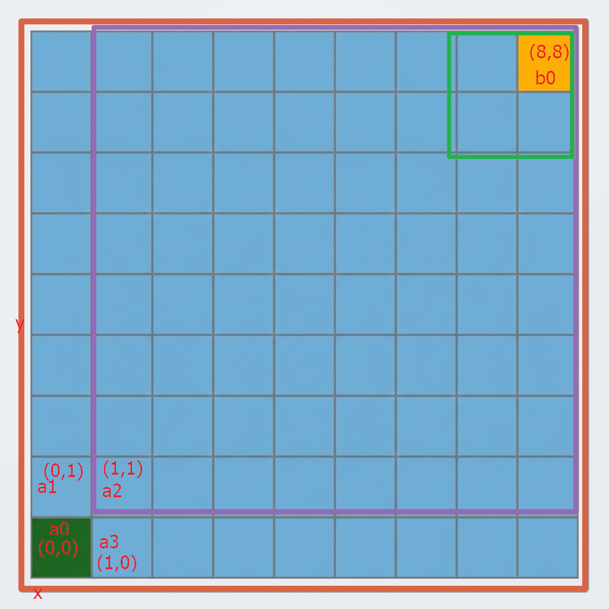
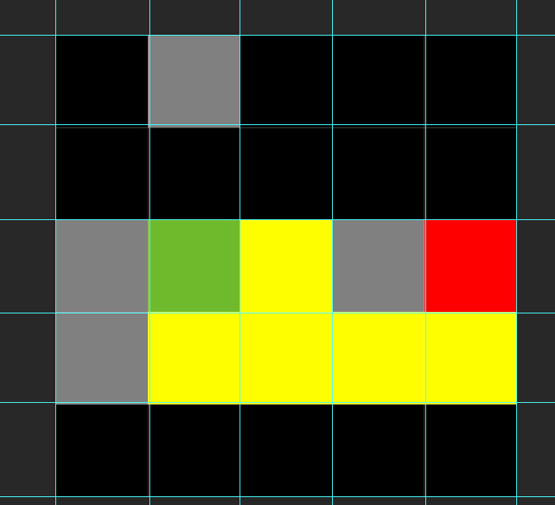

# A*算法


## 推导过程

```
F(a1) = G(a1) + H(a1)

a1 = G(|(x1-x2)|+|(y1-y2)|) + H(|(x1-x2)|+|(y1-y2)|)

a1 =  G(|(0-0)|+|(0-1)|) + H(|(0-8)|+|(1-8)|)

a1 = G(1)+H(15)

a1 = 16

gh(x2-x1)+(y2-y1) = (1-0)+(1-0) = gh2=1.4

a2 = G(1.4)+H(14)

a3 = G(1)+H(15)


open list

a1 = 16

a3 = 16


close list

a2 = 15.4
```

## 坐标轴概念

## 欧几里得距离
$$
\sqrt{(x2-x1)+(y2-y1)}
$$
## 曼哈顿距离

$$
(x1-x2)+(y1-y2)
$$

## 总结

### 20261010
* S:昨天通过查看各种视频去学习A星算法，也自己做了一部分的推导，感觉自己对A星算法的整体逻辑已经很了解了。
* T:是今天早上起来的时候，想去用具体的代码去实现一下A星算法。
* A:然后早上九点零六分的时候开始着手去做，创建了一个算法项目。然后去编写了一个A星的类，然后整体就是写得一团糟，也不知道自己在写什么，最后算法的实现也没有达到预期。
* R:然后中午吃完饭之后想着去总结一下今天早上的编写过程。
* T:从今天早上的情况来看，实际上我对A星算法的整个逻辑的理解应该并没有完全理解。感觉现在去着手转换为代码还是太过早了，还是需要对A星算法的整体逻辑做一个完整的推导和清晰的理解。

下午推导。
1. 首先计算起始节点周围节点
2. f = g(|a|-|b|)+h(|a|-|b|)
3. 取最后放进去的最小值。
4. 要记录上个节点，方便最后回溯。



```md


open

a1(1,1)=6

a3(1,3)=6

b1(2,1)=6

c3(2,4)=8

d1(1,4)=8
e3(3,4)=8


close

a0->a2(2,2)=4

a2->b3(2,3)=6

b3->c4(1,3)=6

b3->c2(3,3)=6

c2->e2(4,3)=6

e2->f1(4,2)=4


4,2 4,3 3,3 2,3 2,2 1,2

f1 e2 c2 b3 a2 a0

```
