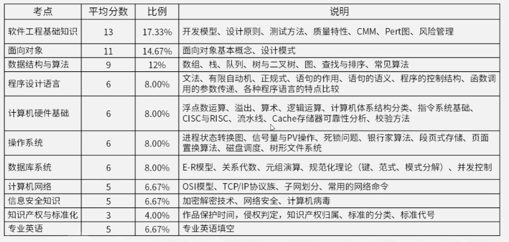

# 索引目录

## 总指导

## 学习规划
### 第一步：诊断
- 严格计时做最近3～5套真题，统计：
- 上午多少分？错在哪些模块？
- 下午多少分？五道题分别拿多少？
- 是知识不会，还是时间不够，还是答题不规范？如果上午低于45，主攻选择题；下午低于45，主攻下午专项。目标定高一点：上午55+，下午50+。

### **第二步：上午题**

刷近5～8年真题，错题按模块归类。记忆性内容：网络协议、数据库范式、UML图、设计模式、知识产权、多媒体。计算题：PV、页面置换、磁盘调度、海明码、CRC、编译原理。英语5题靠计算机词汇积累。每天刷30～50题，周末复盘错题。

### **第三步：下午题专项**

每天手写1道，对照解析改。重点：

DFD：父图子图平衡、数据流命名、外部实体/加工/数据存储。

数据库：E-R转关系模式、主外键、范式、SQL。

UML：用例关系 include/extend/泛化，类图多重性，状态图事件。

算法：动态规划、贪心、分治、回溯、图。填空看上下文和变量含义，不会也要写部分。

设计模式：单例、工厂、适配器、观察者、策略、装饰器、代理，背场景和结构。Java/C++选自己熟的，不要临时换。

### **第四步：全真模拟**

考前6周，每周至少2套，上午下午连做，严格计时。上午150分钟75题，下午150分钟5题。练时间分配和心态。

第五步：错题本+重复

错题不是抄一遍，而是写：错因、对应知识点、正确思路、下次怎么识别。每周复习一次。

如果自学五年都没过，建议换策略：报个班、找一对一、加学习群，或者找已过的人帮你批改下午题。有时候不是你不努力，而是没人给你反馈。

最后，五年没过不丢人，但继续用同样的方法，大概率还是同样的结果。你只需要一次真正的改变：真题驱动、短板优先、动手输出、定期复盘。如果你愿意，可以告诉我最近一次上午/下午分数、卡住的题型，我可以帮你做一个更具体的补差计划。

## 上午内容
- [编译原理-考试版](上午内容/编译原理-考试版.md)
- [1.计算机系统知识](上午内容/1.计算机系统知识.md)
- [5.软件工程基础知识](上午内容/5.软件工程基础知识.md)
- [6.结构化开发方法](上午内容/6.结构化开发方法.md)
- [7.面向对象技术](上午内容/7.面向对象技术.md)
- [10.网络与信息安全基础知识](上午内容/10.网络与信息安全基础知识.md)

# 下午内容

## 模拟考试

### 2016年上半年（上午）
- [第一次测验(20260921)](/preview.html?file=/Qr1mln-notes/exam/2016-shang-1.xlsx){target="_blank" rel="noopener"}
- [第二次测验(20260930)](/preview.html?file=/Qr1mln-notes/exam/2016-shang-2.xlsx){target="_blank" rel="noopener"}

### 2017年上半年（上午）
- [第一次测验(20261003)](/preview.html?file=/Qr1mln-notes/exam/2017-shang-1.xlsx){target="_blank" rel="noopener"}
- [第二次测验(20261006)](/preview.html?file=/Qr1mln-notes/exam/2017-shang-2.xlsx){target="_blank" rel="noopener"}

### 2018年上半年（上午）
- [第一次测验(20261007)](/preview.html?file=/Qr1mln-notes/exam/2018-shang-1.xlsx){target="_blank" rel="noopener"}
- [第二次测验(20261009)](/preview.html?file=/Qr1mln-notes/exam/2018-shang-2.xlsx){target="_blank" rel="noopener"}

### 2019年上半年（上午）
- [第一次测验(20261011)](/preview.html?file=/Qr1mln-notes/exam/2019-shang-1.xlsx){target="_blank" rel="noopener"}

总结：
没见过的题型错的比较多，而且都是概念题，反而是计算题，改的都是参数，没改思路，反而简单多了。

### 参考内容
https://ebook.qicoder.com/%E8%BD%AF%E4%BB%B6%E8%AE%BE%E8%AE%A1%E5%B8%88/notes/201911%E8%BD%AF%E8%AE%BE%E4%B8%8A%E5%8D%88%E7%9C%9F%E9%A2%98.html