## 浮点数的表示
表示
N = 尾数*基数(指数)
运算

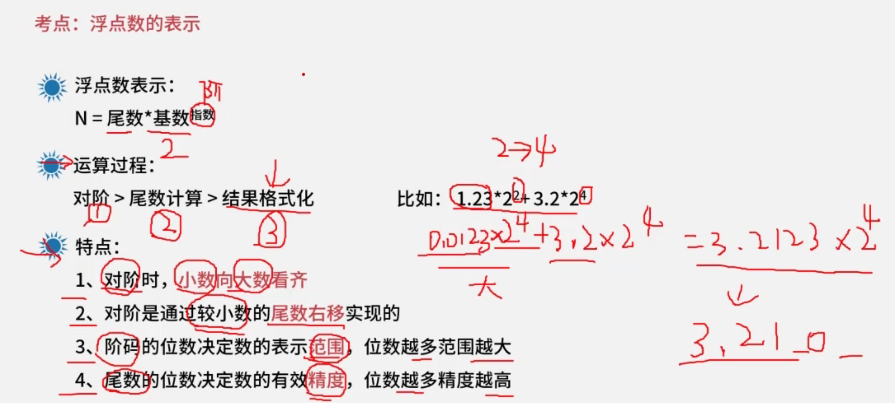

## 进制转换
常见进制
二(B)、八(O)、十(D)、十六(H)
基本概念
数码：0,1,2,3,4,5,6,7,8,9
基数：10
位权：10k
k:小数点左边：0开始，右边-1开始。
进制转换
X进制转十进制
规则：数码*位权+。。。
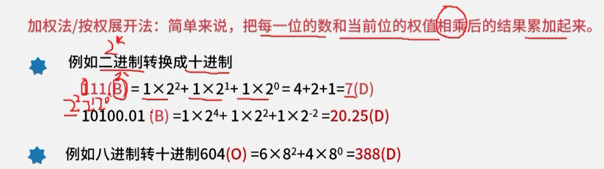

十进制转X进制

规则：短除法。
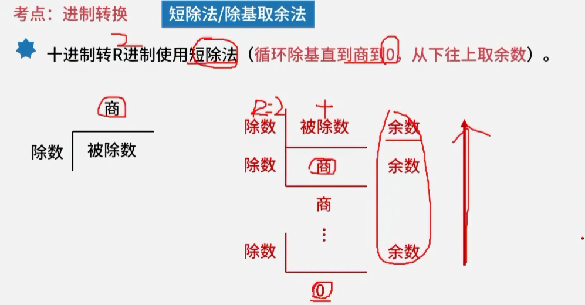

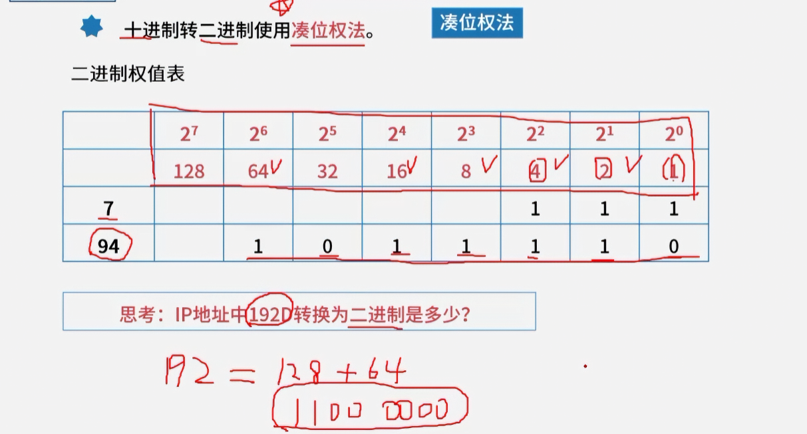

二进制转八进制&十六进制
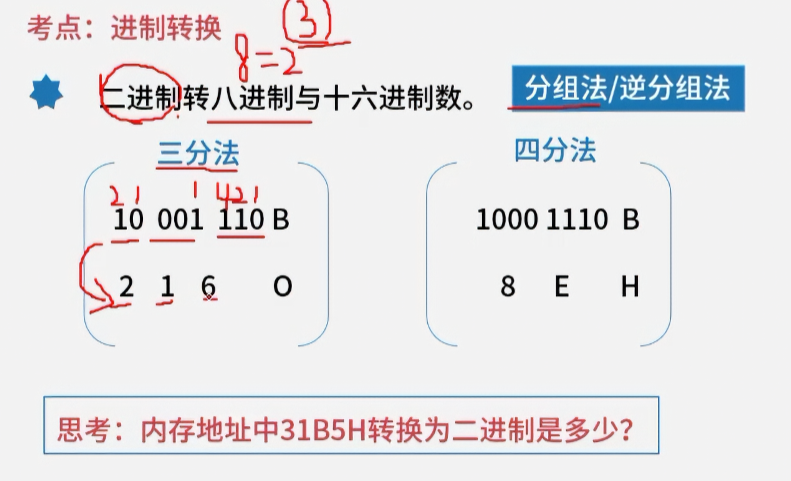

## 码制
### 码制类型
> 原码、反码、补码、移码。

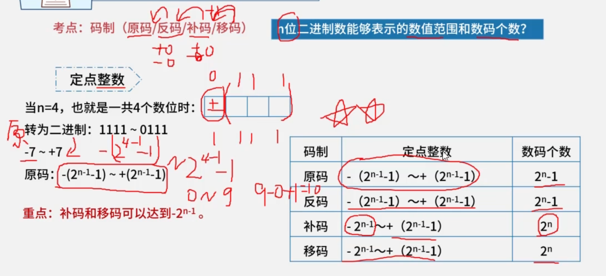

## PV操作

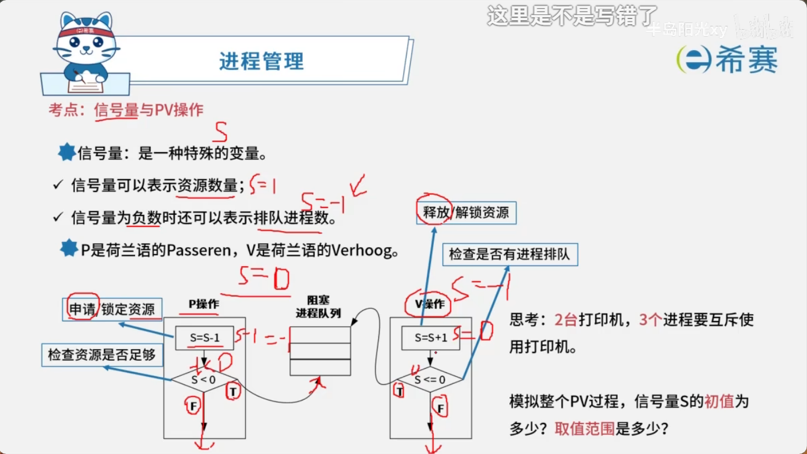
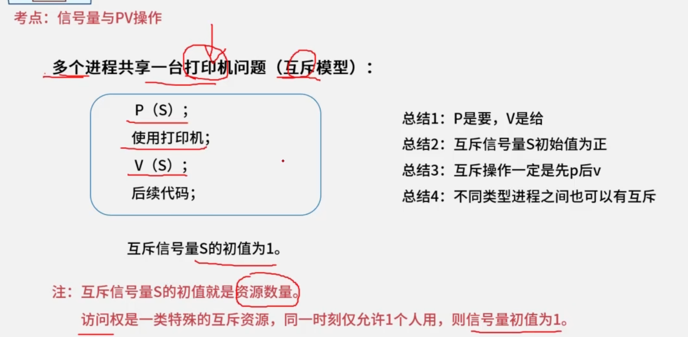
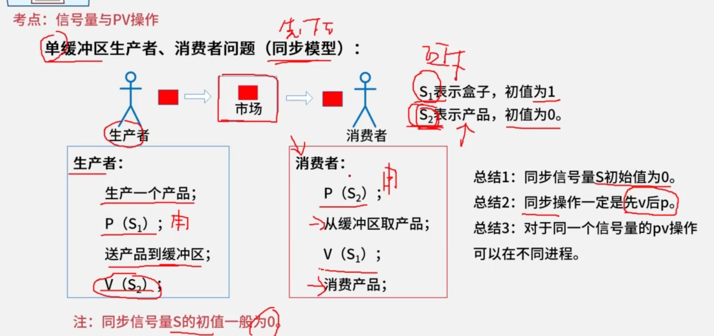
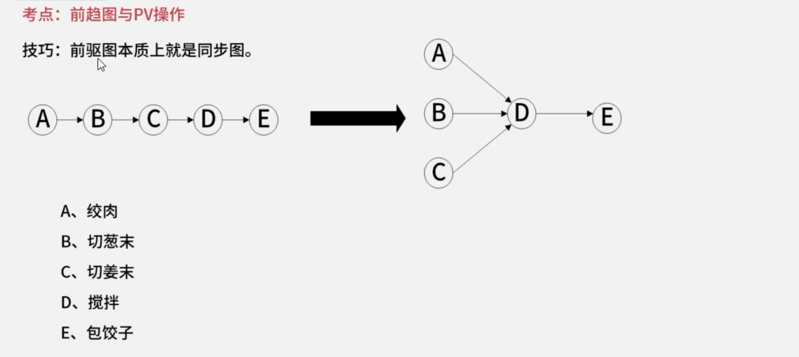
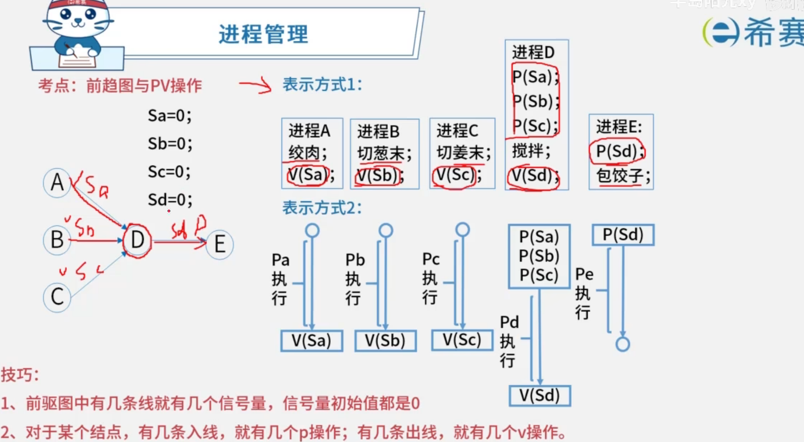

## 磁盘概念
### 核心公式
- 读取一块时间=寻道时间+旋转延迟时间+传输时间
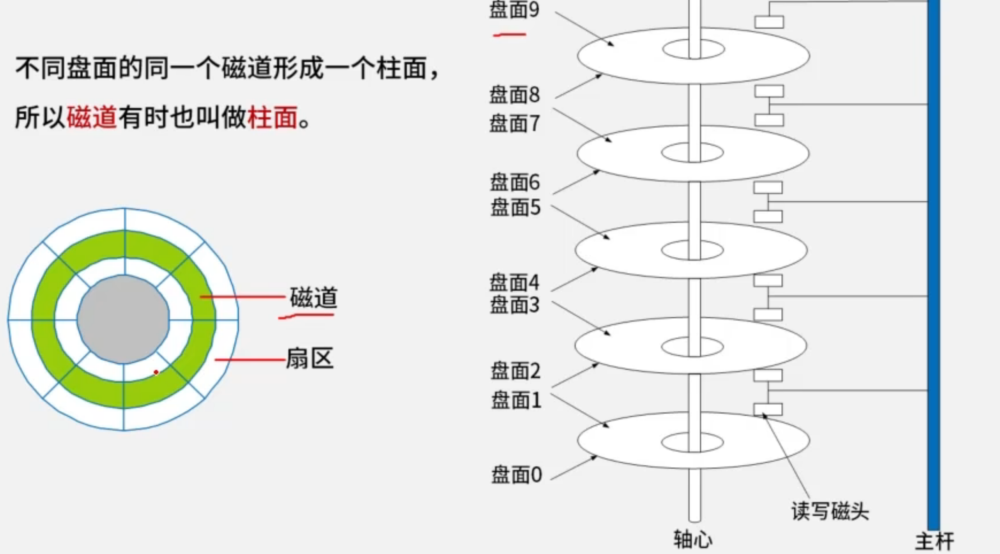

## 存储系统
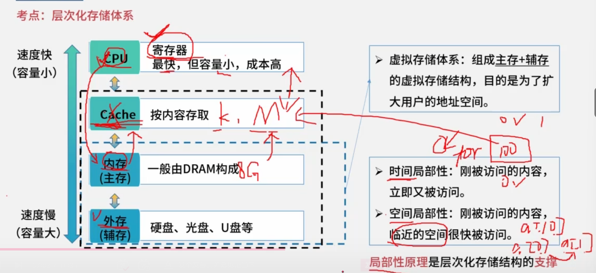
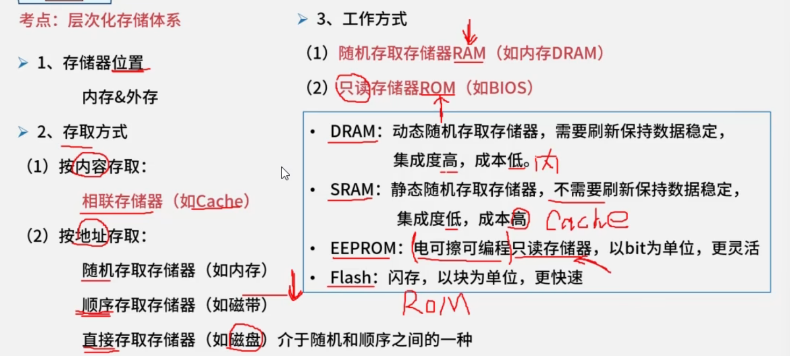

### 内存编址
- 1字节(B) = 8b
- 总容量 = 存储单元个数 * 编址内容。
- 总片数 = 总容量/每片容量。

## 校验码

### 海明码
$$
2^r >= m + r + 1
$$

## 可靠性

MTTF：平均无故障失效率，可靠性。

MTTR：平均故障修复时间，维护性。

MTBF：平均故障间隔时间，可用性。

### 串联可靠度

$$
R = R_1*R_2*R_3*R_N
$$

### 并联可靠度

$$
R = 1 -(1-R_1)*(1-R_2)*(1-R_3)*(1-R_n)
$$

$$
R = 1 -(1-R_n)^n
$$

## 进程管理

> 死锁，两个进程相互等待要求对象释放资源。

死锁4条件必须同时满足。

| 条件       | 案例 |
| ---------- | ---- |
| 互斥       |      |
| 保持和等待 |      |
| 不剥夺     |      |
| 环路等待   |      |

系统不可能发生死锁的最小资源数 = (w - 1)*m+1<=n

资源数 = n

进程数 = m

最小资源数 = w

通过表格法计算

| 进程1 | 进程2 | 进程3 |
| ----- | ----- | ----- |
| R1    |       |       |
| R2    |       |       |
| R3    |       |       |

## 存储管理

### 页式存储
> 程序与内存划分为相同大小的块。

$$ 逻辑地址 = 页号 + 页内地址 $$
$$ 物理地址 = (物理块号)页帧号 + 页内地址 $$

## 编译原理

### 语言处理程序
#### 表达式
* 前缀表达式
* 中缀表达式
  
  
* 后缀表达式（逆波兰表达式）

思路：先通过栈画树结构，。

* 答案：D

## 阶段划分的编译器
词法分析：将源程序分解为单词符号（Token），如标识符、关键字、运算符等。

语法分析：根据语言的语法规则，分析程序中的句子结构是否正确，例如表达式、语句、程序块的结构是否符合文法。

语义分析：检查程序语义是否正确，如类型匹配、变量是否声明等。

代码生成：将中间代码转换为目标代码。

## 示位图

$$
字编号=⌊物理块号⌋/32
$$

某文件管理系统在磁盘上建立了位示图（bitmap），记录磁盘的使用情况。若磁盘上物理块的编号依次为：0，1，2，…；系统中的字长为32位，位示图中字的编号依次为：0，1，2，…，每个字中的一个二进制位对应文件存储器上的一个物理块，取值0和1分别表示物理块是空闲或占用。假设操作系统将2053号物理块分配给某文件，那么该物理块的使用情况在位示图中编号为 （27） 的字中描述。

（27） A. 32  B. 33  C. 64  D. 65
