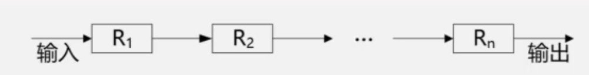
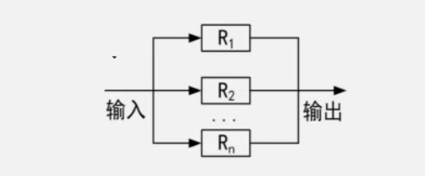
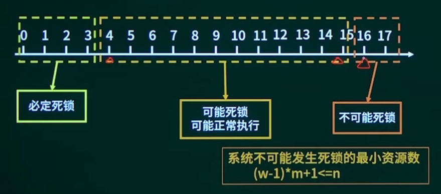
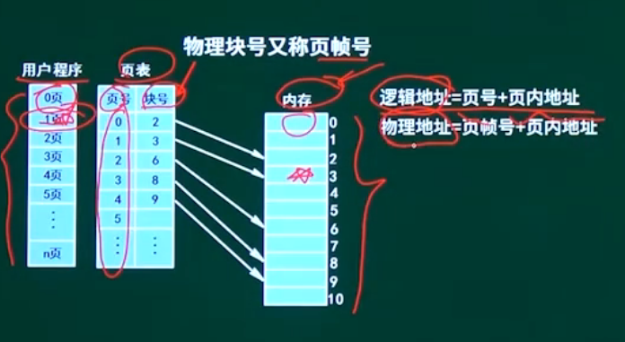
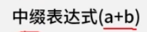
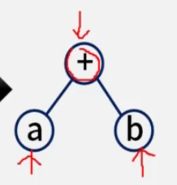
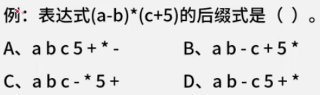
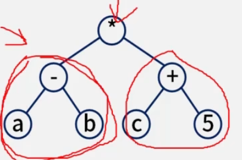

## 校验码

### 海明码
$$
2^r >= m + r + 1
$$

## 可靠性

MTTF：平均无故障失效率，可靠性。

MTTR：平均故障修复时间，维护性。

MTBF：平均故障间隔时间，可用性。

### 串联可靠度

$$
R = R_1*R_2*R_3*R_N
$$

### 并联可靠度

$$
R = 1 -(1-R_1)*(1-R_2)*(1-R_3)*(1-R_n)
$$

$$
R = 1 -(1-R_n)^n
$$

## 进程管理

> 死锁，两个进程相互等待要求对象释放资源。

死锁4条件必须同时满足。

| 条件       | 案例 |
| ---------- | ---- |
| 互斥       |      |
| 保持和等待 |      |
| 不剥夺     |      |
| 环路等待   |      |

系统不可能发生死锁的最小资源数 = (w - 1)*m+1<=n

资源数 = n

进程数 = m

最小资源数 = w

通过表格法计算

| 进程1 | 进程2 | 进程3 |
| ----- | ----- | ----- |
| R1    |       |       |
| R2    |       |       |
| R3    |       |       |

## 存储管理

### 页式存储
> 程序与内存划分为相同大小的块。

$$ 逻辑地址 = 页号 + 页内地址 $$
$$ 物理地址 = (物理块号)页帧号 + 页内地址 $$

## 编译原理

### 语言处理程序
#### 表达式
* 前缀表达式
* 中缀表达式
  
  
* 后缀表达式（逆波兰表达式）

思路：先通过栈画树结构，。

答案：D