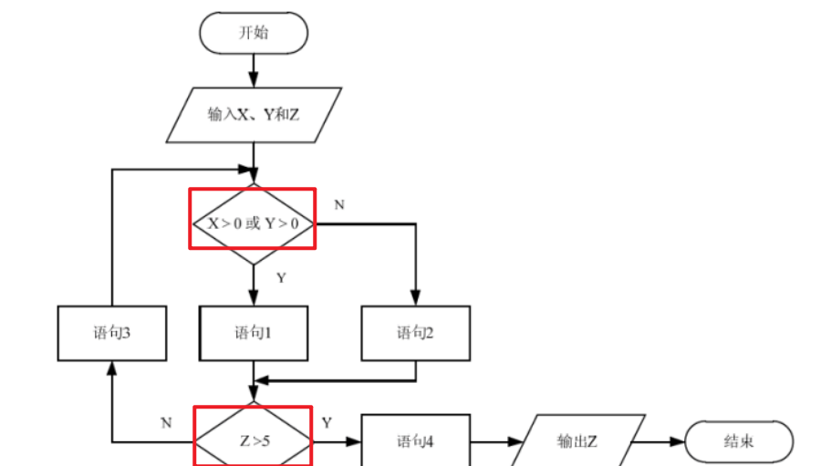
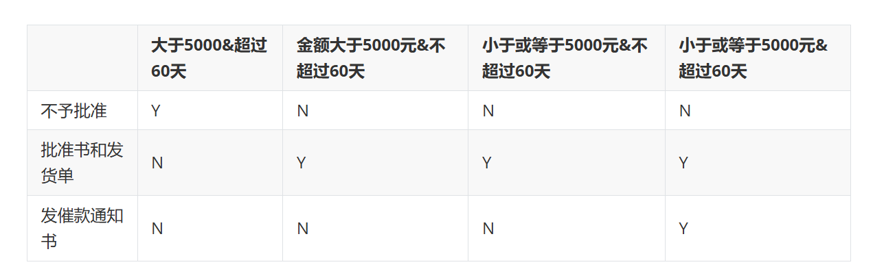

## 

## 团队沟通

核心公式
无主
沟通渠道 = n * (n - 1)/2
一人主程序员
沟通渠道 = n-1 

## 软件测试

### 白盒测试
> 代码逻辑测试。
> 领域：开发做单元测试。

* 语句覆盖：保证每一条语句都必须要至少执行一次,覆盖率低。

* 路径覆盖：保证每条逻辑路径都执行一遍，覆盖率高。

* 分支覆盖：保证判断真假都被执行一次。

### 黑盒测试

* 1
* 2

### 环路复杂度

1. **公式法**：

   
   $$
   V(G)=E−N+2
   $$
   

   其中 E*E* 是控制流图的边数，N*N* 是节点数（适用于连通图）。

2. **判定节点法**：
   $$
   V(G)=P+1
   $$
   

   其中 P*P* 是判定节点数（出度为 2 或以上的节点）。

### 决策表
> 分析问题中的动作和条件规则。

### CMMI

记忆 CMMI 连续式模型的能力等级（CL），可以抓住 **“从无到有、从做到管、从管到定、从定到量、从量到优”** 的递进逻辑。

### 1. 六个能力等级关键词

| 等级 | 名称       | 核心关键词              | 通俗理解 |
| :--- | :--------- | :---------------------- | :------- |
| CL0  | 不完整     | 未执行/未完成           | 没做     |
| CL1  | 已执行的   | 输入→输出，实现特定目标 | 做了     |
| CL2  | 已管理的   | 策划、监控、资源、职责  | 管了     |
| CL3  | 已定义的   | 组织标准过程、裁剪      | 定了     |
| CL4  | 定量管理的 | 统计技术、定量控制      | 量了     |
| CL5  | 优化的     | 持续改进、缺陷预防      | 优了     |

### 2. 口诀记忆

**“零不完整，一执行，二管理，三定义，四定量，五优化。”**
或者：**“执、管、定、量、优”**，对应 CL1～CL5。

### 软件调试

- **试探法**：凭经验猜测错误位置，逐步排查。
- **回溯法**：从错误症状出发，沿代码逻辑回溯，直到找到错误。
- **归纳法**：从测试暴露的问题出发，收集正确和不正确的数据，分析它们之间的关系，提出假想的错误原因，再用数据证明或反驳，最终定位错误。
- **演绎法**：先提出可能的原因假设，然后通过测试排除或确认。