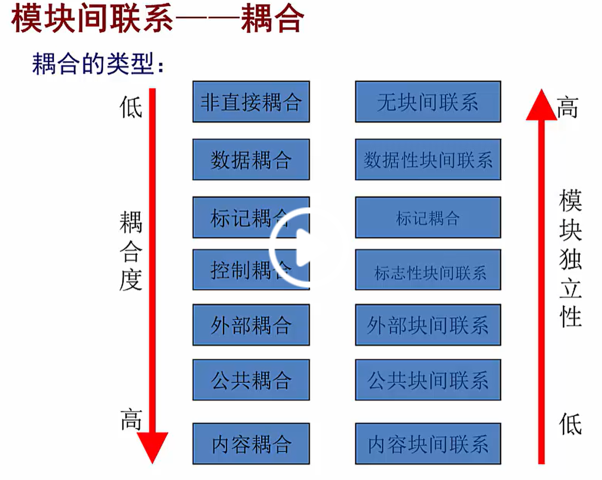
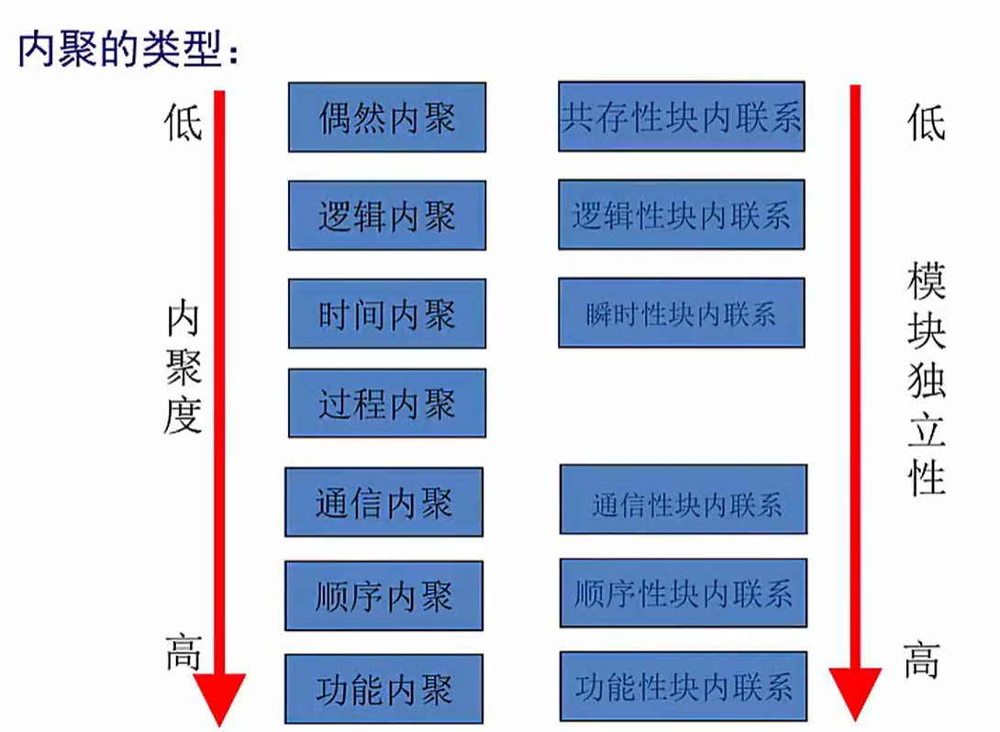

## 模块化设计

### 耦合度

> 模块间调用的关联程度。

无直接耦合：模块间没有联系。

数据耦合：模块间传递的是简单的数据类型。

标记耦合：模块间传递的是数据结构。

控制耦合：模块间传递的是控制状态，会改变另一个模块的执行流程。

外部耦合：模块间调用同一个外部设备。

公共耦合；模块间调用一块公共区域。

内容耦合：模块间存在，相同的内容块。

### 内聚

> 模块内部是通过什么方法组织在一起的。

偶然内聚：没有任何关系的内聚，别名巧合内聚。

逻辑内聚：具有相似的逻辑过程，而内聚到一起。

时间内聚：在同一时间内都要执行的代码，而聚合到一起。

过程内聚：收同一控制流支配，按顺序执行，例如：统计后打印。

通信内聚：具有相同通信数据而被聚到一起的。

顺序内聚：上个输出是下个处理的数据按顺序执行而聚合的。

功能内聚：按照某个功能把不可分割的部分聚合在一起。