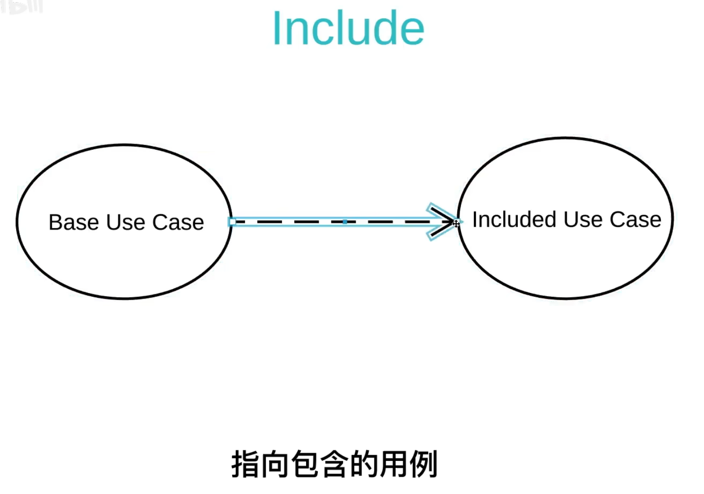
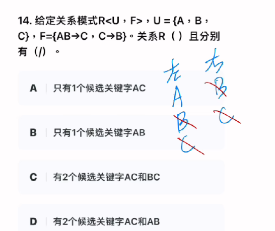

# 神技解法
## 消消乐

###  左右法

> 快速确定主键

| 关系依赖左边值 | 关系依赖右边值 |
| -------------- | -------------- |
| A1             | A2             |
| A2             | A3             |
| A3             |                |

左右对消

结果

| 关系依赖左边值 | 关系依赖右边值 |
| -------------- | -------------- |
| A1             |                |
|                |                |
|                |                |

主键必定有A1。

### 3种情况

1. 两边没有可消情况(必定存在 部分函数依赖)。

| 关系依赖左边值 | 关系依赖右边值 |
| -------------- | -------------- |
| A1             | A4             |
| A2             | A5             |
| A3             |                |

2. 右边剩一个，右边被消完（主键必定包含A）。

3.关系表达式右边存在相同值，基本就是传递依赖。

