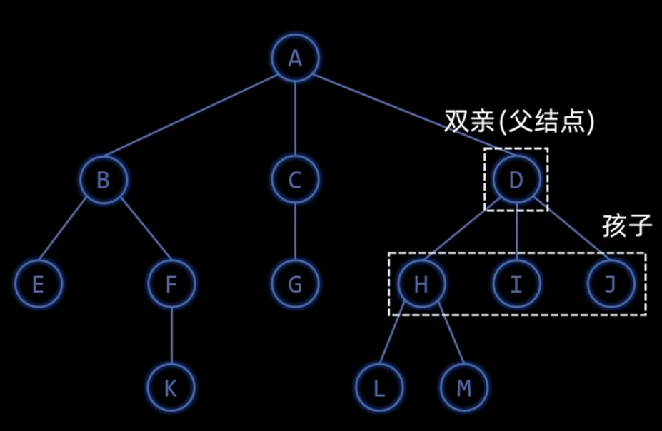
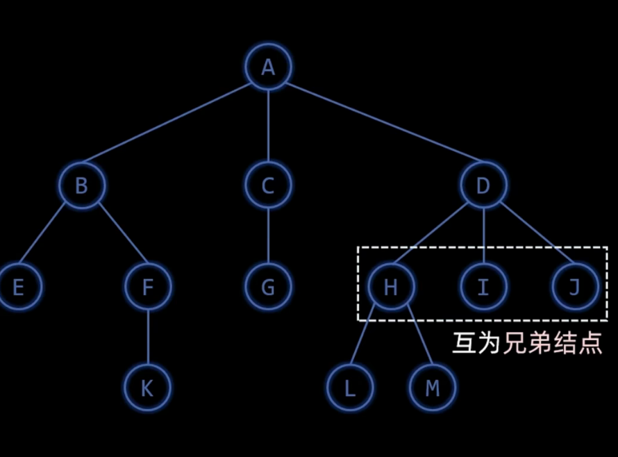
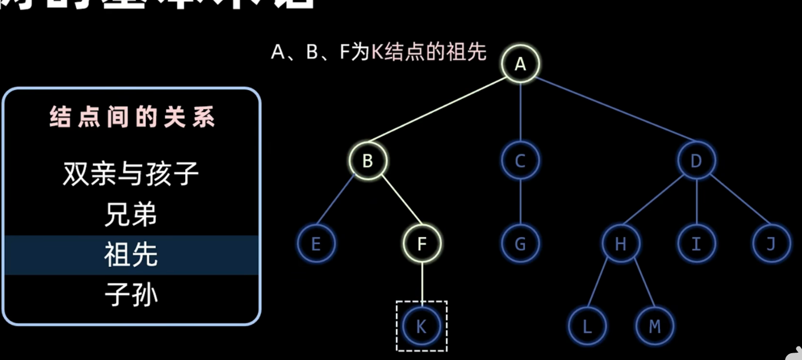
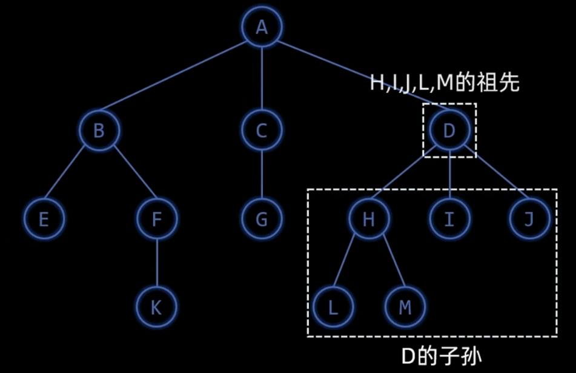
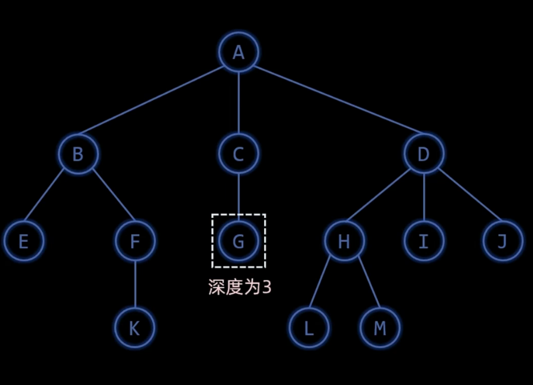
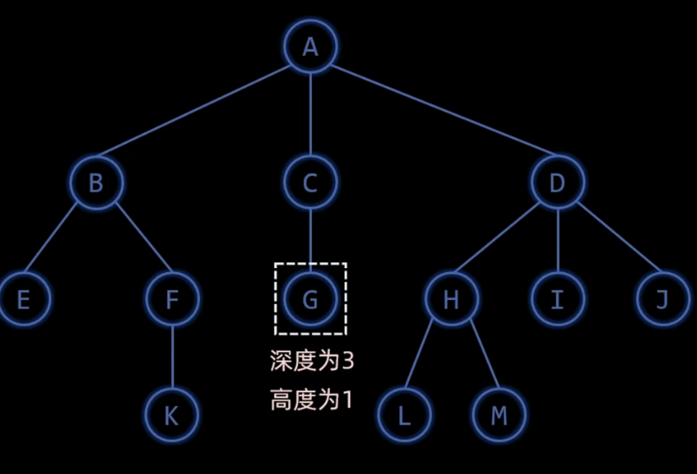
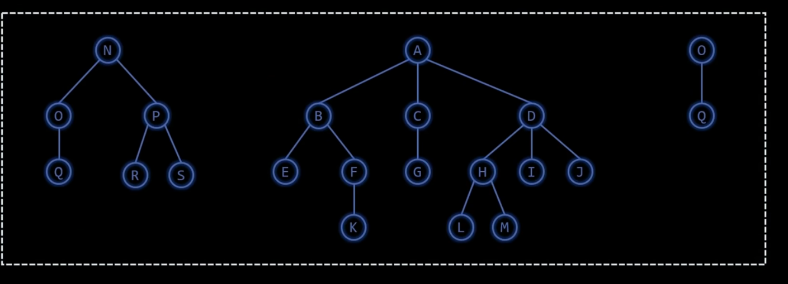
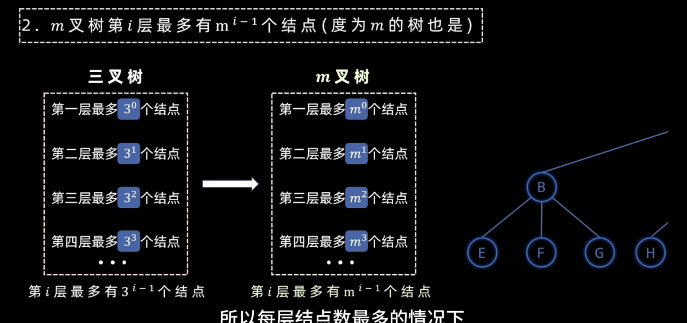

# 树概念
1. 树是个有限集合。
2. 只能有一个根节点。
3. 每个子节点只能有一个根节点。
4. 树是递归结构。
5. 节点总数字母(n)。

## 树的定义
### 节点间的关系
#### 父节点&孩子节点

#### 兄弟

#### 祖先

#### 子孙

### 层

#### 树的层
> 高度/深度/层数相同。

#### 节点的层
##### 节点的深度
> 它所在的层次。

##### 节点的高度
> 以它为根的子树的层数。

### 结点的度
> 孩子的个数。

### 叶子节点
> 度为0的节点。

### 分支节点
> 度大于0的节点。

### 树的度
> 树中节点的最大度数。

### 有无序树

### 路径
> 两个节点上节点的序列（从上往下）经过的边数就是路径长度。

### 森林
> 不相交的几棵树。

## 树的公式推导

### 节点的总数

$$$
    节点总数(n) = 边数 + 1 =
    节点总数(n) = 所有节点度数之和 + 1
    节点总数(n) = n0+n1+n2
$$$

### m树根据层的节点个数

$$$
    nh = m^{h-1}
$$$